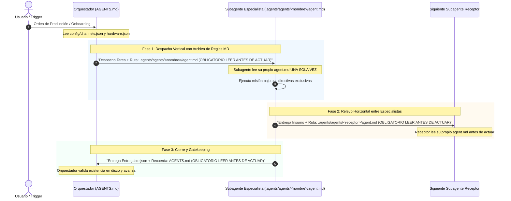
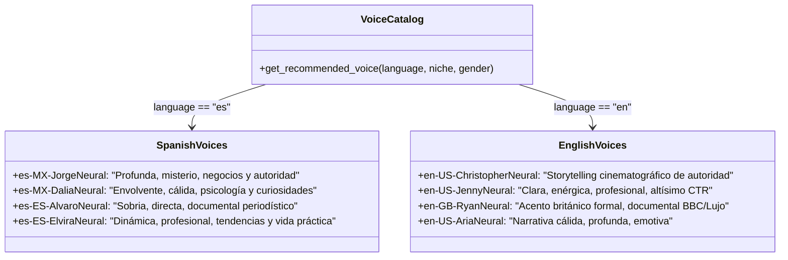
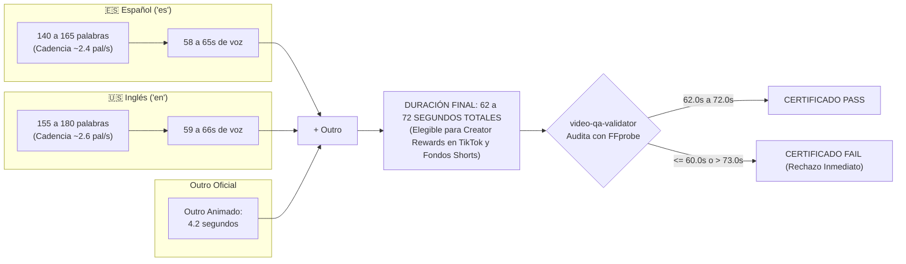

# 🧠 Knowledge Graph Maestro - VideoStudio-Facelessviral-CLI
### Ontología, Red de Entidades, Flujo de Datos, Gobernanza y Cadena de Custodia

Este documento mapea exhaustivamente la arquitectura técnica, las entidades, el flujo de datos, la matriz de responsabilidades (RACI) y las reglas innegociables de la factoría de videos verticales para **YouTube Shorts, TikTok e Instagram Reels**.

---

## 1. Grafo Global de Entidades y Dependencias

```mermaid
flowchart TD
    subgraph Config ["⚙️ CAPA 1: CONFIGURACIÓN, PERFILES Y SESIONES"]
        C0["SETUP_ONBOARDING.md<br/>(Paso 0: Grill-Me & Idioma)"]
        C1["config/channels.json<br/>(Grupos de Canales, Idioma, Voz Oficial y Nichos)"]
        C2["config/hardware.json<br/>(Encoder GPU NVENC/AMF o CPU)"]
        C3["config/sessions/[canal]/<br/>(Sesiones y Cookies Aisladas por Canal)"]
        C4["config/stock_credentials.json<br/>(APIs de Stock: Pixabay y Pexels / Modo Híbrido)"]
    end

    subgraph Orchestration ["🎬 CAPA 2: DIRECCIÓN Y GOBERNANZA (CERO TRABAJO DE CAMPO)"]
        ORCH["Orquestador / Director de Producción<br/>(AGENTS.md / CLAUDE.md)<br/>• Gatekeeping y Verificación<br/>• Despacho con MD Obligatorio<br/>• Monitoreo de Tiempos"]
    end

    subgraph Agents ["🤖 CAPA 3: LOS 9 SUBAGENTES ESPECIALISTAS"]
        AG1["1. trend-researcher<br/>(.agents/agents/trend-researcher/agent.md)<br/>Geo-Targeting según Idioma"]
        AG2["2. viral-scriptwriter<br/>(.agents/agents/viral-scriptwriter/agent.md)<br/>Guión 5 Compases: 62-72s"]
        AG3["3. viral-copywriter<br/>(.agents/agents/viral-copywriter/agent.md)<br/>Investigación real yt-dlp: Título <70 chars"]
        AG4["4. visual-asset-reviewer<br/>(.agents/agents/visual-asset-reviewer/agent.md)<br/>Auditoría Visual de Frames: Cero Basura"]
        AG5["5. video-renderer<br/>(.agents/agents/video-renderer/agent.md)<br/>Aceleración GPU + Voz Oficial Fija"]
        AG6["6. video-qa-validator<br/>(.agents/agents/video-qa-validator/agent.md)<br/>Auditoría Multi-Segundo: Puerta 62-72s"]
        AG7["7. thumbnail-designer<br/>(.agents/agents/thumbnail-designer/agent.md)<br/>Extracción de Frame Real + Badge 74px"]
        AG8["8. packaging-archiver<br/>(.agents/agents/packaging-archiver/agent.md)<br/>Carpeta Fechada + Purga de Temporales"]
        AG9["9. social-media-publisher<br/>(.agents/agents/social-media-publisher/agent.md)<br/>Subida Desatendida con Sesión Aislada"]
    end

    subgraph Artifacts ["📦 CAPA 4: ARTEFACTOS Y MANIFIESTOS INTERCAMBIADOS"]
        ART1["trend_brief.json"]
        ART2["video_script.json"]
        ART3["viral_metadata.json"]
        ART4["approved_materials.json"]
        ART5["video_final.mp4"]
        ART6["qa_certificate.json<br/>(PASS / FAIL)"]
        ART7["miniatura_viral.jpg"]
        ART8["package_manifest.json + copy_publicacion.txt"]
        ART9["publication_receipt.json"]
    end

    subgraph Tools ["🛠️ CAPA 5: MOTORES Y HERRAMIENTAS SUBYACENTES"]
        T1["Google Trends RSS / search_web"]
        T2["yt-dlp + YouTube Autocomplete API"]
        T3["MoneyPrinterTurbo (Motor de Descarga)"]
        T4["FFmpeg (Hardware NVENC / AMF / CPU)"]
        T5["Edge-TTS (Locución Neuronal Consistente)"]
        T6["Pillow (Composición Tipográfica 74px)"]
        T7["scripts/connect_account.py (Login Interactivo)"]
    end

    subgraph Storage ["💾 CAPA 6: ALMACENAMIENTO Y DISTRIBUCIÓN FINAL"]
        S1["assets/b-roll/<categoria>/<br/>(Biblioteca Permanente de Stock)"]
        S2["videos/publicaciones/[CANAL]/[FECHA]_[slug]/<br/>(Entrega Empaquetada Lista)"]
        S3["Plataformas: YouTube Shorts / TikTok / Reels"]
    end

    %% Conexiones de Onboarding y Configuración
    C0 --> C1
    C1 -->|Idioma, Voz Oficial y Rango [62, 72]| ORCH
    C2 -->|Encoder Óptimo| AG5
    C3 -->|Credenciales Aisladas| AG9

    %% Despachos del Orquestador
    ORCH -->|1. Despacha Investigación| AG1
    ORCH -->|2. Despacha Guión| AG2
    ORCH -->|3. Bifurcación Paralelo SEO| AG3
    ORCH -->|3. Bifurcación Paralelo Stock| AG4
    ORCH -->|4. Despacha Renderizado| AG5
    ORCH -->|5. Gatekeeper QA| AG6
    ORCH -->|6. Despacha Miniatura tras PASS| AG7
    ORCH -->|7. Despacha Empaquetado| AG8
    ORCH -->|8. Despacha Publicación| AG9

    %% Flujo de Insumos y Artefactos
    AG1 -->|fetch_trends_data.py| T1
    T1 --> ART1
    ART1 --> AG2

    AG2 --> ART2
    ART2 --> AG3
    ART2 --> AG4

    AG3 -->|fetch_viral_intelligence.py| T2
    T2 --> ART3

    AG4 -->|Descarga Paralela 4 Hilos| T3
    AG4 -->|Auditoría Visual de Frames| S1
    AG4 --> ART4

    ART2 & ART3 & ART4 --> AG5
    AG5 -->|Edge-TTS + FFmpeg NVENC| T4 & T5
    T4 --> ART5

    ART5 --> AG6
    AG6 -->|Auditoría Multi-Segundo 5s, 25s, 45s, 62s| ART6

    ART6 -->|Resultado PASS| AG7
    ART5 & ART3 --> AG7
    AG7 -->|create_viral_thumbnail.py| T6
    T6 --> ART7

    ART5 & ART7 & ART3 & ART6 --> AG8
    AG8 --> ART8
    ART8 --> S2

    ART8 & C3 --> AG9
    AG9 -->|Publicación Desatendida| S3
    S3 --> ART9
```

---

## 2. Grafo del Flujo de Onboarding e Identidad de Canales

```mermaid
flowchart TD
    START["Inicio: config/channels.json vacío o 'configurar canal'"] --> Q1{"Paso 1: ¿Qué acción deseas realizar?"}
    
    Q1 -->|A| SETUP["Configurar Grupo de Canales"]
    Q1 -->|B| SUGGEST["Pedir sugerencias al Trend Researcher"]
    Q1 -->|C| DEMO["Modo Piloto / Demo Local (Sin redes)"]
    Q1 -->|D| SKIP["Saltar y operar bajo demanda"]
    
    SUGGEST -->|Analiza Mercado| TR_OPTS["2-3 Grupos de Canales Propuestos"]
    TR_OPTS --> SETUP

    SETUP --> STEP_LANG{"Paso 2: Idioma y Target de Audiencia"}
    STEP_LANG -->|Español (Latam y España)| ES_CONF["Idioma: 'es'<br/>• Tráfico Masivo y Alta Interacción<br/>• Guión: 140 a 165 palabras<br/>• Google Trends: geo='ES' y geo='MX'"]
    STEP_LANG -->|Inglés Tier 1 (US, UK, CA, AU)| EN_CONF["Idioma: 'en'<br/>• RPM Publicitario 3x a 5x superior<br/>• Guión: 155 a 180 palabras<br/>• Google Trends: geo='US' y Global"]

    ES_CONF & EN_CONF --> STEP_PURPOSE{"Paso 3: Propósito del Canal"}
    STEP_PURPOSE -->|Monetización / Ganancias| PURP_MON["Alto RPM, Negocios, Finanzas, Misterio, Curiosidad"]
    STEP_PURPOSE -->|Entretenimiento / Viralidad| PURP_ENT["Humor, Curiosidades Asombrosas, Cultura Pop"]

    PURP_MON & PURP_ENT --> RULE_DURATION["⚠️ REGLA UNIVERSAL DE DURACIÓN:<br/>Ambos propósitos se fijan estrictamente en [62, 72] segundos<br/>(Cumple Creator Rewards y Monetización)"]

    RULE_DURATION --> STEP_VOICE{"Paso 4: Identidad Sonora Unificada (Voz Oficial Fija)"}
    
    STEP_VOICE -->|Español| V_ES["Catálogo Oficial Español:<br/>1. es-MX-JorgeNeural (Masculina - Misterio/Negocios)<br/>2. es-MX-DaliaNeural (Femenina - Psicología/Curiosidades)<br/>3. es-ES-AlvaroNeural (Masculina - Documental/Sobrio)<br/>4. es-ES-ElviraNeural (Femenina - Dinámica/Tendencias)"]
    
    STEP_VOICE -->|Inglés| V_EN["Catálogo Oficial Inglés:<br/>1. en-US-ChristopherNeural (Masculina - Cine/Storytelling)<br/>2. en-US-JennyNeural (Femenina - Profesional/CTR)<br/>3. en-GB-RyanNeural (Masculina - Británico/BBC/Lujo)<br/>4. en-US-AriaNeural (Femenina - Narrativa Cálida)"]

    V_ES & V_EN --> STEP_PLATS["Paso 5: Plataformas y Vinculación Zero-Tech"]
    STEP_PLATS --> WIN_MAC{"Lanzador de Conexión"}
    WIN_MAC -->|Windows| W_SCH["schtasks con /it (Ventana al frente)"]
    WIN_MAC -->|Linux/Mac| L_RUN["python3 scripts/connect_account.py"]
    W_SCH & L_RUN --> DETECT_COOKIES["Detección de Cookies Reales -> Cierre Automático"]
    DETECT_COOKIES --> SAVE_PROFILE["Ficha guardada en config/channels.json<br/>Sesión aislada en config/sessions/[canal]/"]
```

---

## 3. Protocolo de Comunicación y Cadena de Reglas (Handshake de Custodia)

Este protocolo garantiza la **máxima eficiencia de tokens** y cumplimiento total sin duplicar texto doctrinal en el contexto del Orquestador:



---

## 4. Matriz de Responsabilidades y Asignación de Reglas (RACI)

Esta matriz delimita tajantemente qué agente es responsable de cada regla técnica, evitando la contaminación del contrato del Orquestador con tareas de campo:

| Dominio / Regla Técnica | Agente Responsable | Archivo de Doctrina | ¿Compete al Orquestador? |
|---|---|---|---|
| **Gatekeeping general y avance de fases** | **Orquestador** | `AGENTS.md` / `CLAUDE.md` | **Sí (Supervisión)** |
| **Control de tiempos y reporte al usuario** | **Orquestador** | `AGENTS.md` | **Sí (Supervisión)** |
| **Onboarding guiado y diagnóstico Paso 0** | **Orquestador** | `SETUP_ONBOARDING.md` | **Sí (Supervisión)** |
| **Gestión de APIs de stock (Pixabay / Pexels)**| `configure_stock_api.py` | `SETUP_ONBOARDING.md` | **Sí (Setup Paso 0)** |
| **Volumen de búsqueda y geo-targeting (ES/EN)** | `trend-researcher` | `.agents/agents/trend-researcher/agent.md` | No (Trabajo de campo) |
| **Estructura 5 compases y conteo de palabras** | `viral-scriptwriter` | `.agents/agents/viral-scriptwriter/agent.md` | No (Trabajo de campo) |
| **Sujetos ancla en inglés para stock** | `viral-scriptwriter` | `.agents/agents/viral-scriptwriter/agent.md` | No (Trabajo de campo) |
| **Vincular voz oficial del canal al guión** | `viral-scriptwriter` | `.agents/agents/viral-scriptwriter/agent.md` | No (Trabajo de campo) |
| **Investigación yt-dlp y Autocomplete** | `viral-copywriter` | `.agents/agents/viral-copywriter/agent.md` | No (Trabajo de campo) |
| **Título $<70$ chars, tags doble capa y debate** | `viral-copywriter` | `.agents/agents/viral-copywriter/agent.md` | No (Trabajo de campo) |
| **Auditoría visual de frames de clips de stock** | `visual-asset-reviewer` | `.agents/agents/visual-asset-reviewer/agent.md` | No (Trabajo de campo) |
| **Rechazo tajante de 3D de arcilla y fondo blanco** | `visual-asset-reviewer` | `.agents/agents/visual-asset-reviewer/agent.md` | No (Trabajo de campo) |
| **Rotación de stock (7 días) y biblioteca B-Roll** | `visual-asset-reviewer` | `.agents/agents/visual-asset-reviewer/agent.md` | No (Trabajo de campo) |
| **Aceleración GPU por hardware (`hardware.json`)** | `video-renderer` | `.agents/agents/video-renderer/agent.md` | No (Trabajo de campo) |
| **Subtítulos al 58% con cápsula negra** | `video-renderer` | `.agents/agents/video-renderer/agent.md` | No (Trabajo de campo) |
| **Música de fondo (BGM) a volumen 0.2 (-20 dB)** | `video-renderer` | `.agents/agents/video-renderer/agent.md` | No (Trabajo de campo) |
| **Outro dinámico de cierre (Canva o local)** | `video-renderer` | `.agents/agents/video-renderer/agent.md` | No (Trabajo de campo) |
| **Auditoría multi-segundo (5s, 25s, 45s, 62s, 66s)** | `video-qa-validator` | `.agents/agents/video-qa-validator/agent.md` | No (Trabajo de campo) |
| **Puerta estricta de duración 62-72s (Monetización)** | `video-qa-validator` | `.agents/agents/video-qa-validator/agent.md` | **Frena avance si FAIL** |
| **Rechazo de pantallas planas o 3D en video final** | `video-qa-validator` | `.agents/agents/video-qa-validator/agent.md` | No (Trabajo de campo) |
| **Extracción de frame heroico del video real aprobado**| `thumbnail-designer` | `.agents/agents/thumbnail-designer/agent.md` | No (Trabajo de campo) |
| **Badge superior 74px + Tipografía Impact amarilla** | `thumbnail-designer` | `.agents/agents/thumbnail-designer/agent.md` | No (Trabajo de campo) |
| **Creación de carpeta fechada y copy_publicacion.txt** | `packaging-archiver` | `.agents/agents/packaging-archiver/agent.md` | No (Trabajo de campo) |
| **Purga de archivos temporales pesados de caché** | `packaging-archiver` | `.agents/agents/packaging-archiver/agent.md` | No (Trabajo de campo) |
| **Subida desatendida multi-plataforma con sesión** | `social-media-publisher`| `.agents/agents/social-media-publisher/agent.md`| No (Trabajo de campo) |

---

## 5. Catálogo Oficial de Voces Neurales por Grupo de Canal

Para mantener una identidad sonora unificada por canal, la voz se fija en el onboarding y se mantiene en todas las producciones:



---

## 6. Puerta de Calidad: Regla Universal de Duración y Conteo de Palabras



---

## 7. Resumen de Gobernanza del Sistema
1. **Separación Estricta:** El Orquestador supervisa, gestiona compuertas y presenta tiempos; los 9 subagentes ejecutan el trabajo especializado.
2. **Eficiencia de Tokens:** Ningún agente lee reglas ajenas ni el Orquestador duplica texto de doctrina; se transmite la ruta con `OBLIGATORIO LEER ANTES DE ACTUAR`.
3. **Cero Sorpresas:** Ningún video llega al empaquetado o redes sin `qa_certificate.json` con estatus `PASS` auditado visualmente en múltiples segundos.
4. **Universalidad de Monetización:** Todos los videos, sin importar nicho o temática, duran entre 62 y 72 segundos para capturar ingresos publicitarios de creadores.