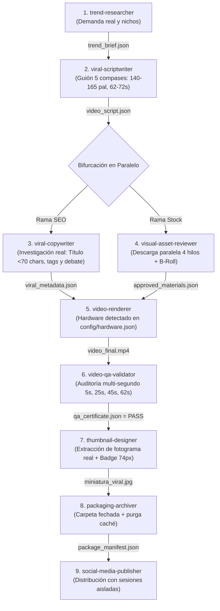

# 🚀 Factoría Autónoma de Video Vertical Multi-Canal
### Motor Maestro de Producción Desatendida con 9 Subagentes Especializados y 3 Pilares

Este repositorio contiene la arquitectura completa, portátil y lista para producción de una **Factoría de Video Automatizada**. Diseñada para operar en cualquier CLI moderna (Antigravity, Claude Code, Cursor, Windsurf, Aider) y en cualquier sistema operativo (Windows, macOS, Linux).

---

## 🗺️ Mapa Rápido del Repositorio

| Archivo / Carpeta | Función Principal |
|---|---|
| [`scripts/setup_environment.py`](file:///c:/ganar%20dinero/scripts/setup_environment.py) | **Instalador 1 Clic:** Audita Python >= 3.10, FFmpeg, instala librerías, detecta hardware y valida 9/9 agentes. |
| [`SETUP_ONBOARDING.md`](file:///c:/ganar%20dinero/SETUP_ONBOARDING.md) | **Protocolo Onboarding (Paso 0):** Entrevista guiada "Grill-Me", vinculación interactiva de cuentas y cadencia. |
| [`AGENTS.md`](file:///c:/ganar%20dinero/AGENTS.md) / [`AGENT.md`](file:///c:/ganar%20dinero/AGENT.md) | **Contrato del Orquestador:** Reglas de despacho, gatekeeping estricto, macro-paralelismo y tiempos. |
| `.agents/agents/<nombre>/agent.md` | **Directorio de los 9 Subagentes:** Misión, herramientas y especificación de entregables. |
| [`config/channels.json`](file:///c:/ganar%20dinero/config/channels.json) | **Fichas de Canales:** Configuración de canales activos, nichos, plataformas y estilo. |
| `config/sessions/[canal]/` | **Almacén de Sesiones:** Credenciales y cookies aisladas por canal (protegidas por `.gitignore`). |
| [`config/hardware.json`](file:///c:/ganar%20dinero/config/hardware.json) | **Hardware Doctor:** Encoder detectado (`h264_nvenc`, `h264_amf`, `h264_videotoolbox` o CPU) y concurrencia. |
| `videos/publicaciones/[CANAL]/` | **Entrega Final:** Paquetes fechados con video aprobado, miniatura viral y `copy_publicacion.txt`. |

---

## 🤖 Directorio Oficial de los 9 Subagentes



1. **`trend-researcher`**: Análisis empírico de mercado y volumen según el propósito (`monetization` vs `entertainment`).
2. **`viral-scriptwriter`**: Redacción de guiones de 5 compases con gancho y sujeto ancla (62-72s, >60s para fondos de monetización).
3. **`viral-copywriter`**: Inteligencia de competencia con YouTube Autocomplete y `yt-dlp`. Títulos obligatorios $< 70$ caracteres, tags de doble capa y comentario fijado de debate.
4. **`visual-asset-reviewer`**: Descarga paralela en 4 hilos de clips de stock, auditoría visual de frames y archivado en B-Roll.
5. **`video-renderer`**: Ensamblado acelerado por GPU (NVENC/AMF/CPU), subtítulos al 58% con cápsula negra y outro dinámico.
6. **`video-qa-validator`**: Gatekeeper multi-segundo (5s, 25s, 45s, 62s). Emite `qa_certificate.json` (`PASS` / `FAIL`).
7. **`thumbnail-designer`**: Se despacha **únicamente tras QA PASS**. Extrae el fotograma heroico del video real y monta el badge móvil de 74px con tipografía Impact amarillo eléctrico.
8. **`packaging-archiver`**: Crea la carpeta fechada `videos/publicaciones/[CANAL]/[FECHA]_[slug]/`, redacta `copy_publicacion.txt` y purga la caché pesada.
9. **`social-media-publisher`**: Publicación desatendida leyendo las sesiones aisladas en `config/sessions/[canal]/`.

---

## 🔑 Protocolo de Vinculación Interactiva de Cuentas (Zero-Tech)

Para conectar plataformas (YouTube Shorts, TikTok, Instagram) sin exigir al usuario claves de Google Cloud ni pasos complejos:

1. **El Orquestador habla de forma humana y directa:**
   > *"Te abro una ventana en tu pantalla. Inicias sesión en tu cuenta como siempre, el sistema detecta que entraste, guarda la sesión y cierra la ventana sola."*
2. **Lanzador Interactivo Universal:**
   - **En Windows:** Utiliza `schtasks /create ... /it /f` seguido de `schtasks /run` a través de [`scripts/run_connect.bat`](file:///c:/ganar%20dinero/scripts/run_connect.bat). La bandera `/it` permite a Windows romper el aislamiento de fondo y mostrar la ventana en el monitor físico del usuario.
   - **En Linux / macOS:** Ejecuta directamente `python3 scripts/connect_account.py --channel [canal] --platform [plataforma]`.
3. **Cierre y Aislamiento Automático:**
   - [`scripts/connect_account.py`](file:///c:/ganar%20dinero/scripts/connect_account.py) abre Google Chrome con protecciones anti-bloqueo.
   - Al detectar las cookies de sesión activa (`LOGIN_INFO`, `SSID`, `SID` o `sessionid`), guarda el estado en `config/sessions/[canal]/[plataforma]_session.json` y **cierra la ventana automáticamente**.
   - Cada canal opera en su propia carpeta aislada, evitando cruces entre marcas.

---

## ⚡ Instalación y Arranque Rápido

```bash
# 1. Instalar dependencias y diagnosticar entorno
python scripts/setup_environment.py

# 2. Iniciar producción para el canal activo
python scripts/produce_channel_video.py --channel imperio_secreto
```
